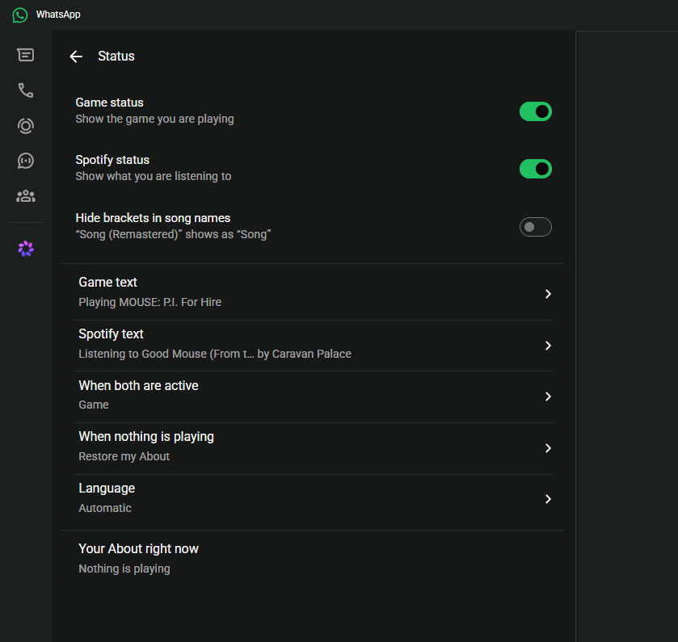
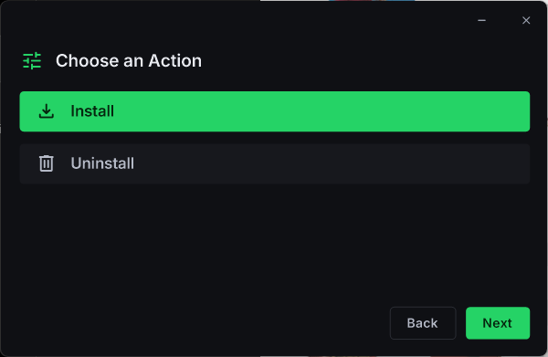
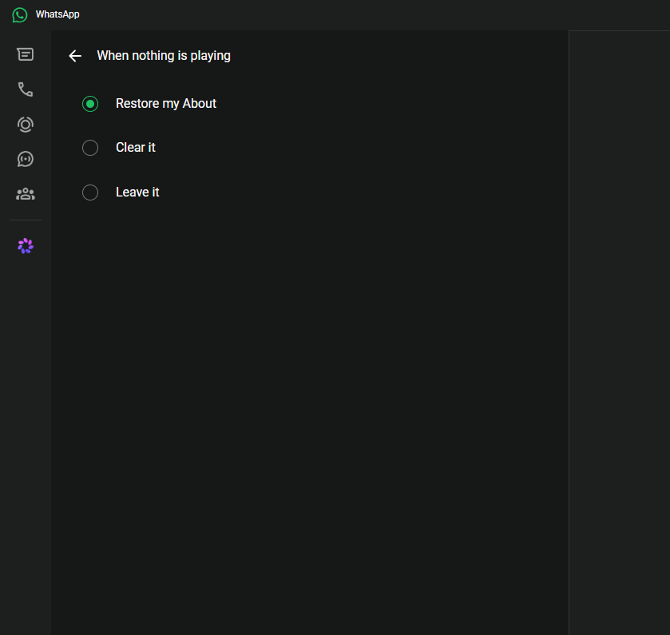
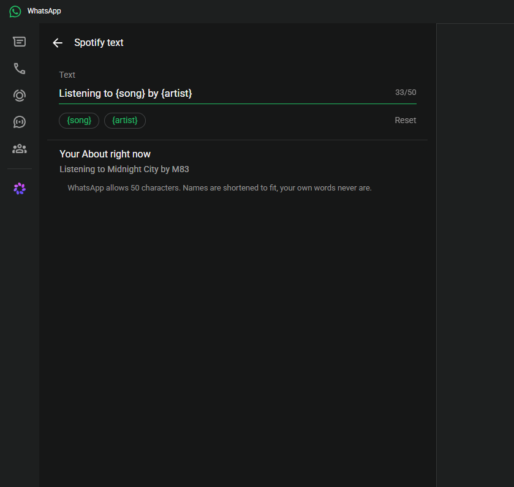
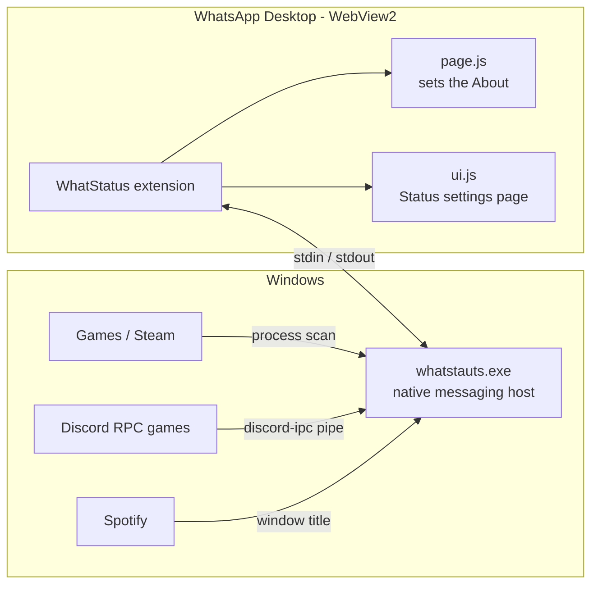

<div align="center">

# WhatStatus

**Your game and music, live in your WhatsApp About.**

Patch WhatsApp Desktop once. From then on, whenever you play a game or listen to Spotify,
your WhatsApp *About* updates itself, and goes back to normal when you stop.


-25D366?logo=whatsapp&logoColor=white)




</div>

> [!WARNING]
> Patching WhatsApp is against WhatsApp's Terms of Service and may lead to account restrictions or bans.
> I (the developer) am not responsible for any account bans, restrictions or other consequences. Use at your own risk.

---

## Features

- **Game status**: detects what you're playing, even games with no Discord integration:
  - games that talk to Discord (Rich Presence), by reading the Discord IPC handshake
  - any game on Discord's list of ~25,000 detectable games, by executable
  - Steam games, by their app id
- **Spotify status**: shows the song and artist you're listening to.
- **Your own wording**: `Playing {game}`, `Winning in {game}`, `Vibing to {song} by {artist}`…
  WhatsApp's 50-character limit is handled for you: names get shortened with "…", your own words never.
- **Native settings page**: a **Status** entry in WhatsApp › Settings, built from WhatsApp's own components, fonts and icons.
- **Puts things back**: your previous About is restored when nothing is playing (or cleared / left alone, your choice).
- **English, Español, Français, Català**: follows WhatsApp's language, changeable in the Status page.
- **One-time patch**: nothing runs at Windows startup. WhatsApp starts WhatStatus itself and closes it when it quits.

## Screenshots

| Installer | Status settings | Editing the text |
|:-:|:-:|:-:|
|  |  |  |

## Install

1. Download `whatstauts.exe` from the [releases](../../releases).
2. Run it, accept the disclaimer, choose **Install**. Windows asks for admin permission once.
3. WhatsApp restarts. Open **Settings › Status** to choose what's shown.

To remove it, run the exe again and choose **Uninstall**.

**Requirements:** Windows 10/11, WhatsApp Desktop from the Microsoft Store, [.NET 8 Desktop Runtime](https://dotnet.microsoft.com/download/dotnet/8.0)
(if it's missing, Windows offers to download it the first time you open the exe).

## How it works



- **The patch** is a single per-user WebView2 policy (`HKCU\Software\Policies\Microsoft\Edge\WebView2\AdditionalBrowserArguments`)
  that makes WhatsApp's WebView2 load the WhatStatus browser extension. That's why admin permission is needed once.
- **The extension** starts `whatstauts.exe` as a [native messaging host](https://learn.microsoft.com/microsoft-edge/extensions-chromium/developer-guide/native-messaging),
  so the exe only lives while WhatsApp is open.
- **The exe** detects activity and sends `{game, music}` to the extension.
- **`page.js`** sets the About through WhatsApp's own modules (the same call its About editor makes), with a short expiry that's renewed while you play,
  so a crash never leaves a stale status for long.

## Build

```powershell
.\build.ps1                       # builds dist\whatstauts.exe
```

Needs the .NET 8 SDK and Python 3 (to bake `ui-src/wa-templates.json` into `ext/ui.js`).

| Path | What |
|---|---|
| `Program.cs` | entry point, install / uninstall, WebView2 policy, native host registration |
| `Gui.cs` | the installer window (custom-drawn WinForms) |
| `Host.cs` | native messaging host: talks to the extension |
| `Games.cs`, `DiscordIpc.cs`, `Media.cs` | game, Discord IPC and Spotify detection |
| `ext/` | the browser extension (`page.js` About logic, `ui.js` settings page, `bridge.js`, `background.js`) |
| `ui-src/` | source of `ext/ui.js` + WhatsApp markup templates |
| `fonts/` | Inter + Material Symbols subsets used by the installer |

## Privacy

Everything stays on your PC. WhatStatus keeps a small log (`%LOCALAPPDATA%\whatstauts\log.txt`) with detected game and song names,
and downloads Discord's public list of detectable games once a day. Nothing is sent anywhere else.

## License

[GPL-3.0](LICENSE). Bundled fonts: see [THIRD_PARTY_NOTICES.md](THIRD_PARTY_NOTICES.md).

WhatStatus is not affiliated with or endorsed by WhatsApp, Meta, Discord or Spotify.
